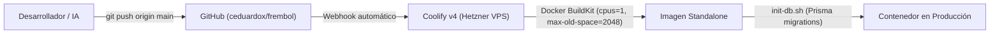

# 🚀 Guía de Despliegue en Producción — FREMBOL

Esta guía describe cómo funciona el despliegue de Frembol en Coolify, cómo hacer despliegues cotidianos sin errores y cómo solucionar problemas comunes.

---

## 1. ¿Cómo funciona el despliegue?

El flujo de despliegue es completamente continuo y automatizado:



1. Haces tus cambios en tu máquina local.
2. Haces commit y `git push origin main`.
3. GitHub notifica a Coolify mediante Webhook.
4. Coolify descarga el nuevo commit y compila la imagen Docker usando los límites optimizados (sin saturar el VPS).
5. Se aplican migraciones pendientes en PostgreSQL (`m2gvlv9mjpu5dv643uzb5m3k`).
6. Se intercambia el tráfico en Traefik hacia el nuevo contenedor sin caída de servicio.

---

## 2. Cómo Desplegar (Paso a Paso)

### Opción A: Despliegue Automático por Git (Recomendado)
Simplemente haz push a `main`:
```bash
git add .
git commit -m "feat: mi nueva funcionalidad"
git push origin main
```
Coolify se encargará del resto de forma automática.

### Opción B: Despliegue Manual desde el Panel de Coolify
Si alguna vez necesitas redesplegar manualmente:
1. Ingresa a tu panel de Coolify: `http://5.78.221.222:8000`
2. Ve al proyecto **FREMBOL** > Aplicación **frembol**.
3. Haz clic en el botón superior **Deploy**.

---

## 3. Variables de Entorno Requeridas en Coolify

En el panel de la aplicación en Coolify (**Environment Variables**), deben estar configuradas:

| Variable | Descripción | Ejemplo / Valor |
| :--- | :--- | :--- |
| `DATABASE_URL` | Conexión interna a PostgreSQL de Coolify | `postgresql://postgres:<password>@m2gvlv9mjpu5dv643uzb5m3k:5432/postgres` |
| `BETTER_AUTH_SECRET` | Clave secreta para autenticación Better-Auth | String de 32+ caracteres |
| `NEXT_PUBLIC_APP_URL` | URL pública de la aplicación | `https://frembol.com` |

---

## 4. Parámetros de Seguridad del Servidor (Ya Configurados)

En la pestaña **Resource Limits** de Coolify, los valores fijados son:
* **Memory Limit:** `2048M` (2 GB)
* **Memory Reservation:** `512M`
* **Memory Swap Limit:** `2560M`
* **CPU Limit:** `1.5`

**¿Por qué estos límites?**
Evitan que una compilación de Next.js o un proceso de Node.js consuma toda la memoria del VPS (8 GB), protegiendo la base de datos MySQL y el resto de los sitios alojados en el servidor.

---

## 5. Checklist para Evitar Errores antes de hacer Push

Antes de subir cambios, asegúrate de:
* [ ] No haber eliminado `cpus: 1` ni `ignoreBuildErrors: true` en `next.config.ts`.
* [ ] No haber eliminado `NODE_OPTIONS=--max-old-space-size=2048` del `Dockerfile`.
* [ ] Probar localmente que la aplicación compile o pase el linter (`npm run check` o `npm run build`).
