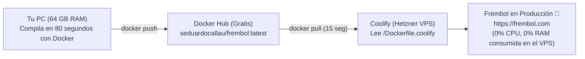

# 🚀 NUEVA COMPILACIÓN Y SUBIDA A PRODUCCIÓN — FREMBOL

**Plataforma:** FREMBOL (Gestión de Taller Automotriz)  
**Ubicación local:** `G:\FRENBOL\torqvoice`  
**Servidor de Producción:** Hetzner VPS (`5.78.221.222`) – Coolify v4  
**Dominio público:** `https://frembol.com`  

---

## 📌 1. ¿Por qué se cambió la forma de compilar?

### El problema anterior:
Anteriormente, cada vez que hacías `git push origin main`, Coolify descargaba el código fuente de GitHub y lo **compilaba directamente dentro del servidor VPS**.
* Frembol creció a más de **210 rutas (110 páginas + 100 APIs)**, 13 idiomas y librerías pesadas como `@react-pdf/renderer`.
* El VPS de Hetzner solo cuenta con **8 GB de memoria RAM compartida** entre Coolify, Traefik y dos bases de datos PostgreSQL en vivo.
* Cada compilación de Next.js exigía más de 3.2 GB de RAM, desbordando el servidor, forzando memoria Swap en disco al 100% y **congelando todas las páginas webs (*Timeouts*) durante 7 a 10 minutos**.

### La nueva solución definitiva (Arquitectura Moderna):
En lugar de forzar al servidor a compilar, **aprovechamos la potencia de tu PC local (64 GB de RAM y 12 hilos de CPU)**:



1. **Tu PC compila** la imagen Docker para Linux en **solo ~80 segundos** sin despeinarse.
2. **Tu PC sube** la imagen a Docker Hub (`seduardocallau/frembol:latest`).
3. **Coolify solo descarga** la imagen terminada en **15 segundos**, ejecuta las migraciones de base de datos y arranca el contenedor.
4. **Resultado:** El servidor VPS Hetzner **NUNCA MÁS se satura ni se congela**.

---

## 🔑 2. Datos y Credenciales Necesarios

Si vas a realizar este proceso desde tu PC o desde otro equipo, estos son los datos clave:

| Elemento | Detalle / Credencial | Notas |
| :--- | :--- | :--- |
| **Cuenta Docker Hub** | `seduardocallau` | Correo: `seduardocallau@gmail.com` |
| **Repositorio Docker Hub** | `seduardocallau/frembol` | Visibilidad: Pública (gratuita) |
| **Imagen Generada** | `seduardocallau/frembol:latest` | Imagen compilada para `linux/amd64` |
| **Panel de Coolify** | `http://5.78.221.222:8000` | Acceso con tu usuario/contraseña web |
| **Proyecto en Coolify** | **FREMBOL** > Aplicación: **frembol** | UUID: `ux5liu8g912mj0anm3kgyzll` |
| **Base de Datos** | PostgreSQL interna de Coolify | UUID contenedor: `m2gvlv9mjpu5dv643uzb5m3k` |
| **URL Pública Oficial** | `https://frembol.com` | Parámetro obligatorio en compilación |

---

## 📁 3. Los 3 Archivos Clave del Proyecto

En el proyecto `G:\FRENBOL\torqvoice` existen 3 archivos especialmente configurados para este flujo:

### A. `build-and-push.ps1` (Script automatizado de 1 Clic)
Script de PowerShell que compila localmente con tu Docker Desktop y sube a Docker Hub automáticamente.

### B. `Dockerfile.coolify` (Para Coolify en el servidor)
Contiene una sola línea:
```dockerfile
FROM seduardocallau/frembol:latest
```
*Le dice a Coolify: "No compiles nada desde cero; simplemente descarga la imagen lista de Docker Hub".*

### C. `Dockerfile` (Para tu PC local)
El Dockerfile completo optimizado para construir la aplicación en modo `standalone`, con soporte de WebSockets (`next-ws`), Prisma 7 y Sharp.

---

## 🚀 4. Guía Paso a Paso para Desplegar (El Flujo Cotidiano)

Cada vez que hagas cambios de código en Frembol y quieras subirlos a producción, sigue estos **3 pasos**:

### Paso 1: Asegurarte de que Docker Desktop esté abierto
1. Abre **Docker Desktop** en tu Windows.
2. Verifica que el icono de la ballena en la barra de tareas (abajo a la derecha) esté verde (*Engine running*).

---

### Paso 2: Ejecutar el script de compilación y subida
Abre una terminal de PowerShell en la carpeta del proyecto y ejecuta:

```powershell
cd G:\FRENBOL\torqvoice
.\build-and-push.ps1
```

**¿Qué hace este script automáticamente?**
1. Comprueba que Docker Desktop esté corriendo.
2. Compila la imagen para Linux inyectando `--build-arg NEXT_PUBLIC_APP_URL=https://frembol.com` (aprovechando tus 64 GB de RAM en ~80 segundos).
3. Sube la imagen a Docker Hub (`docker push seduardocallau/frembol:latest`).
4. Te muestra un mensaje verde confirmando el éxito.

---

### Paso 3: Desplegar en Coolify (15 segundos)
1. Entra a tu panel de Coolify: `http://5.78.221.222:8000`
2. Ve a **Projects** > **FREMBOL** > Aplicación **frembol**.
3. Haz clic en el botón superior **Deploy**.
4. ¡Listo! Coolify descargará la nueva imagen en ~15 segundos y `https://frembol.com` estará actualizado sin caídas.

---

## 💻 5. Comandos Manuales Paso a Paso (Por si no usas el script)

Si estás en otra máquina o prefieres ejecutar los comandos manualmente uno por uno:

### 1. Iniciar sesión en Docker Hub (solo la primera vez en la máquina):
```bash
docker login
# Ingresas usuario: seduardocallau y tu contraseña
```

### 2. Compilar la imagen localmente:
```bash
docker build --platform linux/amd64 --build-arg NEXT_PUBLIC_APP_URL=https://frembol.com -t seduardocallau/frembol:latest .
```
> [!IMPORTANT]
> Es crucial incluir `--build-arg NEXT_PUBLIC_APP_URL=https://frembol.com`. Si no se incluye, Next.js tomará `localhost:3000` por defecto y mostrará el aviso rojo de *Invalid Origin* en la pantalla de inicio de sesión.

### 3. Subir la imagen a Docker Hub:
```bash
docker push seduardocallau/frembol:latest
```

### 4. Ir a Coolify y presionar **Deploy**.

---

## ⚙️ 6. Configuración Fija en Coolify (Ya configurada)

En Coolify, la aplicación `frembol` debe mantenerse configurada de la siguiente manera:

1. **Pestaña Configuration > Build & deploy:**
   * **Build strategy:** `Dockerfile`
   * **Base directory:** `/`
   * **Dockerfile location:** `/Dockerfile.coolify`  *(¡Muy importante! Debe ser `.coolify`)*
2. **Pestaña Environment Variables:**
   * `DATABASE_URL`: `postgresql://postgres:<password>@m2gvlv9mjpu5dv643uzb5m3k:5432/postgres`
   * `BETTER_AUTH_SECRET`: String seguro de 32+ caracteres.
   * `NEXT_PUBLIC_APP_URL`: `https://frembol.com`
   * `PORT`: `3000`

---

## 🛡️ 7. Puntos Críticos y Aprendizajes Técnicos

1. **Tu Base de Datos NUNCA se toca:**
   * La base de datos PostgreSQL vive en su propio contenedor permanente (`m2gvlv9mjpu5dv643uzb5m3k`) con un volumen persistente de disco en Hetzner.
   * Compilar imágenes o reiniciar el contenedor de Frembol no borra ni modifica los datos de los talleres, clientes ni vehículos.
2. **El origen del aviso rojo (*Invalid Origin*):**
   * En Next.js (`better-auth`), el origen se valida estrictamente. Si alguna vez ves el cartel rojo de advertencia, significa que la imagen se compiló sin el argumento `--build-arg NEXT_PUBLIC_APP_URL=https://frembol.com`.
3. **El archivo `Dockerfile.coolify` debe estar en Git:**
   * Cuando Coolify hace el despliegue, descarga el repositorio desde GitHub y busca el archivo que le indicaste en *Dockerfile location*. Si creas ramas nuevas, asegúrate de que `Dockerfile.coolify` esté incluido.

---

## ❓ 8. Solución de Problemas Frecuentes

### Problema A: "Docker Desktop no está ejecutándose"
* **Causa:** El servicio o programa Docker Desktop está cerrado en Windows.
* **Solución:** Abre el programa **Docker Desktop** desde el menú Inicio o escritorio y espera 20 segundos a que la ballena en la barra de tareas esté verde.

### Problema B: "denied: requested access to the resource is denied" al hacer push
* **Causa:** Se cerró la sesión de Docker Hub en tu máquina.
* **Solución:** Ejecuta `docker login` en la terminal e ingresa con tu usuario `seduardocallau`.

### Problema C: Coolify se queda compilando por más de 3 minutos
* **Causa:** En Coolify, el campo **Dockerfile location** volvió a ponerse en `/Dockerfile` (el viejo) en lugar de `/Dockerfile.coolify`.
* **Solución:** Cancela el despliegue, ve a la configuración de la app en Coolify, cambia la ruta a `/Dockerfile.coolify`, dale a **Save** y pulsa **Deploy**.
